# 🛡️ Quality Gate

**English** · [Português](./README.md)

<p align="center">
  
  
  
  
</p>

<p align="center">
  
  
  
  
  
  
  
  
</p>

<p align="left">
  <strong>A deterministic quality gate: a coverage ratchet that only moves up, multi-stack checks and an autonomous PR babysitter.</strong><br />
  Drop-in CI/CD scripts that block silent coverage regressions, audit licenses, catch leaked secrets and check containers, with no paid cloud service.
</p>


> "Real software needs mathematical guarantees at its base, not promises from LLMs. AI helps with the exceptions; plain CPU and determinism guard the gate." (Akita Way)

---

## Overview

**Quality Gate** is a set of scripts and GitHub Actions workflows that governs a repository. It runs on local CPU and on native GitHub Actions, so the code never leaves your infrastructure and the cost stays at zero. AI is optional and only ever adds advisory signals.

It works on four fronts:

1. **Local validation in one command (`local-validate.cjs`)**: runs linters, unit tests, secret detection and commit-message checks before anything reaches Git.
2. **Coverage ratchet (`quality-gate.js`)**: records statements, branches, functions and lines in `scripts/baseline.json` and fails any change that lowers them. It also tracks lint errors and file size.
3. **Pull request readiness (`pr-snapshot.cjs`, `babysit-loop.cjs`)**: reads the state of required checks, merge policy and review threads, then reports one of a fixed set of states (`ready`, `wait_ci`, `fix_required_check`, and so on).
4. **Specialized gates**: Docker image checks, architecture boundaries, diff coverage, license audit, AI evals and a cross-file AST check, described below.

The focus is on fast, reproducible feedback for human developers and AI coding agents (Codex, Claude Code, local agents), so that code merged into the main branch is never worse than what was there before.

---

## Demo

<p align="center">
  
</p>

<p align="center">
  
</p>

---

## Flow

```mermaid
flowchart LR
    A["Code and local tests"] --> B["local-validate<br/>(lint, secrets, tests)"]
    B --> C["Coverage ratchet<br/>(upward only)"]
    C --> D["GitHub Actions<br/>(parallel jobs)"]
    D --> E["PR snapshot<br/>(state and blockers)"]
    E --> F["Babysitter loop<br/>(fix, push, wait)"]
    F --> G["Merge-ready<br/>(baseline updated)"]

    classDef dark fill:#450a0a,color:#fff,stroke:#7f1d1d
    classDef red fill:#b91c1c,color:#fff,stroke:#7f1d1d
    classDef hot fill:#dc2626,color:#fff,stroke:#b91c1c
    classDef orange fill:#f97316,color:#111827,stroke:#ea580c
    classDef amber fill:#f59e0b,color:#111827,stroke:#d97706
    class A dark
    class B,C red
    class D hot
    class E,F orange
    class G amber
    linkStyle default stroke:#7f1d1d,stroke-width:2px
```



---

## Who is it for

- Teams that want one CI/CD policy across Node.js and Python (uv) repositories
- Open source maintainers who need contributors to never lower existing coverage
- Developers who want a fast, deterministic check before opening a pull request
- Operators of AI coding agents who need an objective gate before generated code is merged

---

## Stack

- **Node.js** for the validation engine, coverage math and automation scripts (no runtime dependencies in the core scripts)
- **Python / uv** support for projects using `pytest`, `pytest-cov`, `ruff` and `pip-audit`
- **React 19 + Ink 7** for the optional terminal UI, bundled into single `.mjs` files
- **GitHub Actions** for the CI pipeline, with parallel jobs per pull request
- **Docker** inspection of Dockerfiles and Compose files, with an optional Docker Image Doctor backend
- **PowerShell / Bash** aliases for local productivity

---

## Prerequisites

*   [x] **Node.js >= 20** (Node.js 22 LTS is recommended for the rich terminal UI)
*   [x] **Git** installed and configured
*   [x] **GitHub CLI (`gh`)** authenticated, for PR and workflow operations
*   [x] **Python 3 + uv**: only for Python/uv projects
*   [x] **Docker**: optional, only for the Docker gate's full mode (a static fallback works without it)

---

## Configuration

### Quick start

Copy the scripts and workflow into your repository, then run the setup from the repository root:

```bash
cp -r path/to/quality-gate/.github          your-project/
cp -r path/to/quality-gate/scripts          your-project/
cp    path/to/quality-gate/sonar-project.properties your-project/

cd your-project
node scripts/doctor.cjs --dry-run
node scripts/setup.js --repo=<owner>/<repo> --skip-sonar
```

Then capture the baseline for your stack (Node example):

```bash
npm run test:coverage:ci
node scripts/quality-gate.js init
git add scripts/baseline.json
git commit -m "chore: set quality gate baseline"
```

From now on the ratchet is active. Run `node scripts/local-validate.cjs --profile pr` before each push.

`setup.js` writes the managed files (`LICENSE`, `.github/FUNDING.yml`, `.github/dependabot.yml`), configures branch protection and the PR ruleset through the GitHub API, and validates the result. Use `--dry-run` to preview every step first. Pass `--sonar-org` and `--sonar-token` only if you use SonarCloud.

### Policy: `.quality-gate/policy.json`

The policy is the contract between the repository and the gates. Every key is optional; missing keys take safe defaults. The main sections:

| Key | What it controls |
|---|---|
| `project.surfaces` | Stacks in the repository (`node` or `python-uv`), with their root folder and whether each is required |
| `ci.requiredChecks` | Job names that must be green for the PR to be ready |
| `ci.advisoryChecks` | Job names that are reported but never block (for example, SonarCloud) |
| `ci.coverageRatchet` | Turns the coverage ratchet on or off |
| `ci.maxFileLines` | Maximum lines per source file, checked by the ratchet |
| `ci.diffCoverage` | `enabled`, `minPercentage` (coverage required on new lines) and `blockOnFailure` |
| `ci.architectureBoundary` | `enabled`, `blockOnFailure` and `rules` for the boundary gate |
| `ci.aiEvals` | `enabled`, `minScore` and `blockOnFailure` for the AI evals gate |
| `localValidation` | Extra untracked files to allow and the pytest temporary-folder pattern |

A minimal example for a Node repository that enables diff coverage and a layer boundary:

```json
{
  "schemaVersion": 1,
  "project": {
    "surfaces": [{ "type": "node", "root": ".", "required": true }]
  },
  "ci": {
    "requiredChecks": ["Security audit", "Lint", "Tests & ratchet", "Docker image gate"],
    "advisoryChecks": ["SonarCloud"],
    "coverageRatchet": true,
    "maxFileLines": 300,
    "diffCoverage": { "enabled": true, "minPercentage": 90, "blockOnFailure": true },
    "architectureBoundary": {
      "enabled": true,
      "blockOnFailure": true,
      "rules": [{ "from": "src/domain/**", "disallow": ["src/infra/**"] }]
    }
  }
}
```

`doctor.cjs` warns about undeclared surfaces and fails when a required surface has no workflow job.

### Optional AI providers

AI is never required. The gates run without it, and the AI evals gate reports `skipped` (not `failed`) when no provider or model is available. Configure the providers only through environment variables:

| Variable | Purpose | Example |
|---|---|---|
| `QG_9ROUTER_URL` | Base URL of a 9Router gateway (OpenAI-compatible) | `<your-gateway-url>` |
| `QG_OLLAMA_URL` | Base URL of an Ollama server. Defaults to Ollama's standard local address when unset | `<your-ollama-url>` |
| `QG_AI_MODEL` | Model name sent to the provider. Takes priority over the local file | `<your-model-name>` |
| `QG_AI_API_KEY` | Optional key, only if your gateway requires one | `<your-api-key>` |

Set them in your shell or CI secrets, never in the repository. A provider without a URL is left out of the list. Local overrides can also go in `.quality-gate/ai.local.json`, which is gitignored.

---

## Usage

### Daily flow

1. Write the change and its tests.
2. Run the full local check:
   ```bash
   node scripts/local-validate.cjs --profile pr
   ```
3. If coverage went up, move the baseline up:
   ```bash
   node scripts/quality-gate.js update
   ```
4. Push and open the pull request:
   ```bash
   git push origin your-branch
   gh pr create --fill
   ```
5. Follow CI from the terminal:
   ```bash
   node scripts/dashboard.cjs
   # or the rich TUI on Node 22+
   node scripts/dashboard-tui.mjs
   ```

### Commands

```bash
# Interactive menu with every check and repair action
node scripts/menu-tui.mjs

# Consistency audit of workflow, setup, baseline and Sonar
node scripts/doctor.cjs --dry-run

# Ratchet: verify, update (only upward), or print the report
node scripts/quality-gate.js check
node scripts/quality-gate.js update --dry-run
node scripts/quality-gate.js report

# Pull request state and babysitter loop
node scripts/pr-snapshot.cjs --pr 42 --json --output .quality-gate/reports/pr-snapshot.json
node scripts/babysit-loop.cjs --pr 42 --once --json

# Dependabot PR consolidation plan (read-only)
node scripts/dependabot-consolidate.cjs --repo <owner>/<repo> --dry-run --json
```

### Local validation for other projects

For a repository you do not want to change, point the validator at its scripts folder. Nothing is copied or committed into the target:

```bash
node path/to/quality-gate/scripts/local-validate.cjs \
  --project path/to/your-project \
  --scripts-root path/to/quality-gate/scripts \
  --profile company --json
```

The `company` profile also runs an advisory `jscpd` duplication scan that does not block.

---

## Gates

| Gate | Command | What it checks | Default behaviour |
|---|---|---|---|
| Secret scan | `scripts/secret-scan.cjs` | Credentials and secrets in tracked files or the diff (`--all`, `--diff`) | Blocks local validation |
| Lint | CI job `Lint` | Node syntax check and ESLint report | Required check |
| Tests and ratchet | CI job `Tests & ratchet`, `scripts/quality-gate.js` | Coverage per metric, lint errors and file size, all compared with the baseline | Blocks on regression |
| Diff coverage | `scripts/diff-coverage-gate.cjs --base <ref>` | Coverage of the lines added by the PR | Configurable with `ci.diffCoverage` |
| License audit | `scripts/license-audit.cjs` | Licenses of dependencies | On demand |
| Commit lint | `scripts/commit-lint.cjs --file <msg>` | Conventional Commits format | On demand |
| Docker gate | `scripts/docker-gate.cjs --project .` | Dockerfile and Compose rules, with Docker Image Doctor or a static fallback | Blocks on critical findings, warns on the rest |
| Boundary gate | `scripts/boundary-gate.cjs` | Forbidden imports between layers, from `ci.architectureBoundary` | Disabled by default |
| Fleet audit | `scripts/fleet.cjs` | Health of many repositories (policy, baseline, hook, workflow) | Read-only, `--strict` to fail |
| AI evals | `scripts/ai-evals-gate.cjs --changed-files <files>` | Golden dataset for prompts, skills and agents, scored against a local provider | Skipped without a provider; `ci.aiEvals` sets the minimum score |
| Inline PR suggestions | `scripts/pr-inline-suggest.cjs --findings <file.json>` | Turns findings into inline review comments on the diff | Dry run by default; `--post` with `--pr` publishes |
| AST cross-file graph | `scripts/ast-graph.cjs --base <ref>` | JS/TS imports of removed exports and calls that no longer match a signature | Read-only; `--strict` to fail |

Gates that run in CI are wired in `.github/workflows/quality-gate.yml`. The others are standalone scripts you can call from `local-validate`, a hook, or your own pipeline.

### Fleet audit

`scripts/fleet.cjs` reads a catalog of local repositories and reports, for each one, whether it is managed and healthy. It never changes files.

```bash
mkdir -p .quality-gate
cp scripts/fleet.example.json .quality-gate/fleet.json
# edit the paths to point to your repositories
node scripts/fleet.cjs --json
```

The catalog is a plain array of paths, or an object with a `repos` list. `.quality-gate/fleet.json` is gitignored and should not be committed. Exit codes: `0` normal run, `2` catalog missing or invalid, `1` only with `--strict` and at least one issue.

---

## Testing the gate

The gate is exercised on real pull requests in a separate repository, **[quality-gate-lab](https://github.com/devAndreotti/quality-gate-lab)**. That is where changes to the gate are checked end to end: passing and failing PRs, coverage ratchet movements, Docker and AI evals behaviour, before they reach the main repository.

To run the unit tests of this repository (Node 20+, no install needed):

```bash
node --test scripts/*.test.cjs
```

---

## Contributing

Contributions are welcome.

1. Fork the repository
2. Create a branch: `git checkout -b feature/your-feature`
3. Commit with a Conventional Commit message: `git commit -m "feat: your change"`
4. Push the branch: `git push origin feature/your-feature`
5. Open a pull request describing the change

Use [Conventional Commits](https://www.conventionalcommits.org/): `feat:`, `fix:`, `docs:`, `style:`, `refactor:`, `test:`, `chore:`.

Plans for the next AI-related gates live in [`PLAN_QG_AI_GAPS_EVOLUTION.md`](./PLAN_QG_AI_GAPS_EVOLUTION.md) and [`IMPLEMENTATION.md`](./IMPLEMENTATION.md).

---

## License

This project is under the **MIT** license. See the [LICENSE](./LICENSE) file for details.

---

<p align="center">
  Desenvolvido com ☕ por <a href="https://github.com/devAndreotti">devAndreotti</a>
</p>
