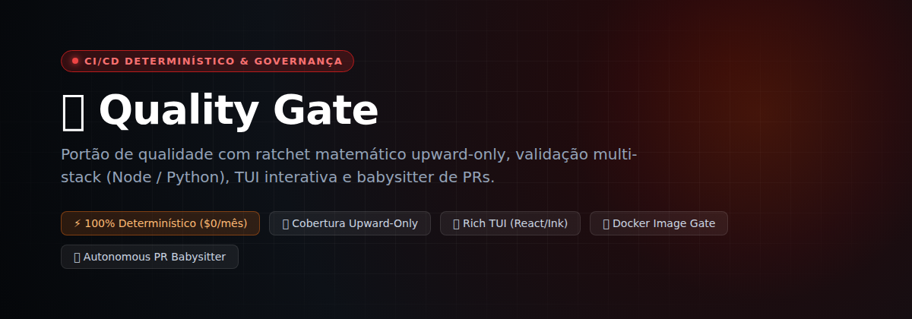
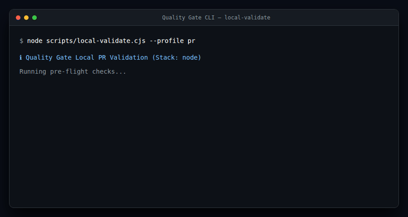
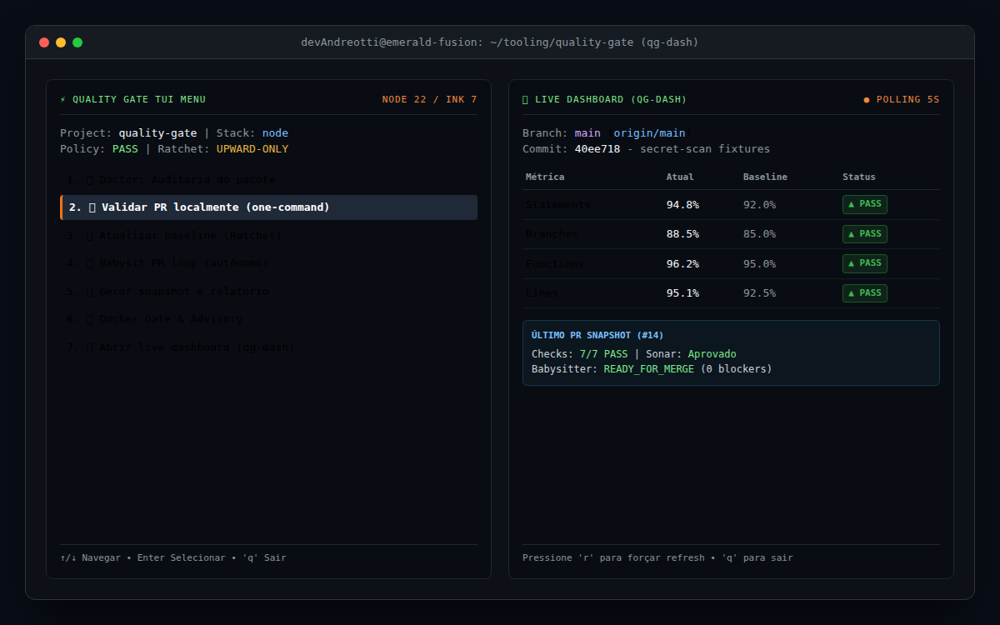

# 🛡️ Quality Gate

<p align="center">
  
  
  
  
</p>

<p align="center">
  
  
  
  
  
  
  
  
</p>

<p align="left">
  <strong>Portão de qualidade determinístico com ratchet matemático upward-only, validação multi-stack e babysitter autônomo de PRs.</strong><br />
  Infraestrutura completa de CI/CD que impede regressões silenciosas de cobertura, audita licenças, detecta vazamentos de segredos e valida contêineres com custo zero de nuvem.
</p>



> "Software de verdade precisa de garantias matemáticas na base, não de promessas de LLMs. IA auxilia nas exceções; CPU pura e determinismo cuidam do portão." — Filosofia Akita Way

---

## Visão geral

**Quality Gate** é uma solução completa de governança e controle de qualidade para repositórios de software modernos. Ele substitui ferramentas proprietárias pesadas e serviços caros em nuvem por scripts leves executados em CPU local e em GitHub Actions nativo, garantindo total privacidade do código e custo financeiro zero.

O sistema atua em quatro frentes coordenadas:

1. **Validação prévia local em comando único (`local-validate.cjs`)**: executa linters, testes unitários, auditoria de licenças de dependências, detecção de segredos e lint de commits antes de qualquer envio ao Git.
2. **Ratchet matemático upward-only (`quality-gate.js`)**: calcula métricas exatas de cobertura de testes (statements, branches, functions, lines) e impede commits que reduzam esses percentuais em relação ao histórico.
3. **Auditoria de contêineres e imagens (`docker-gate.cjs`)**: avalia arquivos Dockerfile e Docker Compose contra boas práticas de segurança através de inspeção estática ou Docker Image Doctor.
4. **Babysitter autônomo de Pull Requests (`babysit-loop.cjs`)**: loop inteligente que monitora o status de CI no GitHub, classifica falhas automaticamente e gera relatórios com sticky comments em formato limpo.

O foco central é fornecer feedback imediato para desenvolvedores humanos e agentes autônomos de IA (Codex, agentes locais, Claude Code), assegurando que o código mesclado à branch principal seja sempre superior ao anterior.

---

## Demo

<p align="center">
  
</p>

<p align="center">
  
</p>

---

## Fluxo

```mermaid
flowchart LR
    A["Código & Testes Locais"] --> B["local-validate\n(Lint, Segredos, Testes)"]
    B --> C["Ratchet de Cobertura\n(Upward-Only)"]
    C --> D["GitHub Actions CI\n(6 Jobs Paralelos)"]
    D --> E["babysit-pr Loop\n(Diagnóstico de Falhas)"]
    E --> F["PR Merge Aprovado\n(Baseline Atualizado)"]

    style A fill:#450a0a,color:#fff,stroke:#7f1d1d
    style B fill:#7f1d1d,color:#fff,stroke:#b91c1c
    style C fill:#b91c1c,color:#fff,stroke:#dc2626
    style D fill:#dc2626,color:#fff,stroke:#ea580c
    style E fill:#f97316,color:#111827,stroke:#ea580c
    style F fill:#f59e0b,color:#111827,stroke:#d97706
    linkStyle default stroke:#7f1d1d,stroke-width:2px
```



---

## Para quem é

- **Desenvolvedores Full-Stack** que precisam de validação rápida e confiável no terminal antes de enviar código para revisão.
- **Equipes de Engenharia** que gerenciam projetos heterogêneos (Node.js e Python/uv) e buscam uma política unificada de CI/CD.
- **Mantenedores Open Source** que desejam assegurar que contribuidores nunca reduzam a cobertura de testes existente no repositório.
- **Operadores de Agentes Autônomos de IA** que precisam de um portão determinístico e autônomo para validar alterações de código geradas por máquinas antes do merge.

---

## Stack

- **Node.js** para o motor principal de validação, cálculo de métricas de cobertura e scripts de automação.
- **Python / uv** para suporte nativo a projetos com `pytest`, `pytest-cov`, `ruff` e `pip-audit`.
- **React 19 + Ink 7** para a interface interativa no terminal (TUI) empacotada em bundle único independente de dependências externas.
- **GitHub Actions** para a esteira automatizada com 6 jobs paralelos de verificação em cada Pull Request.
- **Docker** para inspeção estática de manifestos de contêineres e integração com ferramentas de segurança.
- **PowerShell / Bash** para aliases rápidos de produtividade local (`qg`, `qg-dash`, `qg-chk`).

---

## Pré-requisitos

*   [x] **Node.js >= 20.x** (Node.js 22 LTS recomendado para execução do TUI rico com Ink)
*   [x] **Git** instalado e configurado localmente
*   [x] **GitHub CLI (`gh`)** autenticado para operações de PR e monitoramento de workflows

---

## Configuração

### 1. Inicialização e Scaffold

Copie os scripts e workflows para o seu repositório de destino e inicialize a política:

```bash
# Execução direta com o script de setup automático
node scripts/setup.js --repo=OWNER/REPO --skip-sonar
```

Ou utilizando o fluxo de aliases em PowerShell com o perfil PowerShell local:

```powershell
qg-init -Yes -Repo OWNER/REPO -SkipBaseline -SkipCommit
```

### 2. Variáveis de ambiente

| Variável | Descrição | Exemplo |
|---|---|---|
| `GITHUB_TOKEN` | Token do GitHub com permissões de administração para configurar proteções de branch e regras de PR. | `ghp_xxxxxxxxxxxxxxxxxxxx` |
| `SONAR_TOKEN` | Token de autenticação do SonarCloud (opcional, exigido apenas se o check do Sonar estiver ativado). | `squ_xxxxxxxxxxxxxxxxxxxx` |

### 3. Testar a instalação

```bash
# Executa a auditoria das políticas e configurações do repositório
node scripts/doctor.cjs --dry-run
```

---

## Uso

### Fluxo diário

1. Implemente suas alterações de código e crie os respectivos testes automatizados.
2. Valide o estado completo do projeto localmente com um único comando:
   ```bash
   node scripts/local-validate.cjs --profile pr
   ```
3. Se a cobertura aumentou, atualize o baseline matemático do ratchet:
   ```bash
   node scripts/quality-gate.js update
   ```
4. Envie o commit e abra o Pull Request no GitHub:
   ```bash
   git push origin sua-branch
   gh pr create --fill
   ```
5. Acompanhe a esteira de CI em tempo real no terminal através do live dashboard:
   ```bash
   node scripts/dashboard.cjs
   # ou via bundle TUI rico no Node 22:
   node scripts/dashboard-tui.mjs
   ```

### Exemplo de execução do menu interativo

```bash
# Abre o menu interativo com todas as opções de verificação e reparo
node scripts/menu-tui.mjs
```

### O que fazer depois

- **Monitorar com babysit-pr**: execute `node scripts/babysit-loop.cjs --pr <NUMERO> --once` para auditar se o PR está pronto para merge.
- **Consolidar Dependabot**: use `node scripts/dependabot-consolidate.cjs --repo OWNER/REPO` para agrupar PRs semanais de dependências.
- **Evolução de IA**: consulte a especificação técnica em [PLAN_QG_AI_GAPS_EVOLUTION.md](./PLAN_QG_AI_GAPS_EVOLUTION.md) para os próximos passos de análise semântica e evals.

---

## Estrutura do projeto

```text
quality-gate/
├── .github/
│   ├── FUNDING.yml                  # Configuração de patrocínio
│   ├── copilot-instructions.md      # Diretrizes para revisores automatizados
│   ├── dependabot.yml               # Atualizações semanais de dependências
│   └── workflows/
│       └── quality-gate.yml         # Esteira de CI com 6 jobs paralelos
├── .quality-gate/
│   ├── policy.json                  # Contrato de políticas e regras exigidas
│   └── policy.schema.json           # Schema formal de validação da política
├── scripts/
│   ├── baseline.json                # Registro imutável das métricas de cobertura
│   ├── babysit-loop.cjs             # Loop de monitoramento e auditoria de PRs
│   ├── ci-diagnose.cjs              # Classificador determinístico de falhas de CI
│   ├── configure-project.cjs        # Adaptador de stack (Node.js ou Python/uv)
│   ├── dashboard.cjs                # Dashboard em texto puro (zero dependências)
│   ├── dashboard-tui.mjs            # Dashboard rico em TUI (React 19 + Ink 7)
│   ├── doctor.cjs                   # Auditoria de integridade do pacote e configs
│   ├── docker-gate.cjs              # Validador de Dockerfile e regras de contêiner
│   ├── local-validate.cjs           # Validação unificada pré-push em comando único
│   ├── menu-tui.mjs                 # Menu interativo TUI (React 19 + Ink 7)
│   ├── quality-gate.js              # Motor matemático do ratchet de cobertura
│   ├── pr-comment.js                # Publicador do comentário sticky de status no PR
│   └── pr-snapshot.cjs              # Gerador de snapshot de PR e mergeabilidade
├── Banner.png                       # Banner de identificação visual do projeto
├── photo.png                        # Captura da interface TUI e Dashboard
├── demo.gif                         # Demonstração animada da CLI em execução
├── LICENSE                          # Licença MIT
├── sonar-project.properties         # Configuração de análise do SonarCloud
└── README.md                        # Documentação do projeto
```

---

## Teste do gate

A versão em inglês deste documento está em [README.en.md](./README.en.md).

O gate é exercitado em pull requests reais no repositório separado [quality-gate-lab](https://github.com/devAndreotti/quality-gate-lab), onde mudanças no próprio gate são validadas de ponta a ponta antes de chegarem ao repositório principal.

---

## SAST local com Semgrep

O repositório tem um scan Semgrep com regras próprias em [`.semgrep/quality-gate.yml`](./.semgrep/quality-gate.yml) (execução do `child_process` com comando dinâmico, `eval`/`new Function` e caminhos de `fs` vindos de `process.argv`). O workflow [`semgrep.yml`](./.github/workflows/semgrep.yml) roda em PRs e na main como **advisory**: não é required check e não bloqueia merge; o resultado vai para Code scanning com categoria `semgrep`.

Para rodar localmente (sem login e sem telemetria):

```bash
pipx run semgrep==1.182.1 scan --config .semgrep/quality-gate.yml --metrics=off
```

Os casos de teste das regras ficam em `.semgrep/tests/`. Para validá-los: `for f in .semgrep/tests/*.js; do pipx run semgrep==1.182.1 --test --metrics=off --config .semgrep/quality-gate.yml "$f"; done`.

---

## Contribuindo

Contribuições são bem-vindas!

1. Faça um fork do repositório
2. Crie uma branch para sua modificação: `git checkout -b feature/sua-feature`
3. Commit suas alterações: `git commit -m "feat: sua modificacao"`
4. Envie a branch para o seu repositório: `git push origin feature/sua-feature`
5. Abra um Pull Request detalhando as alterações propostas

Utilize o padrão [Conventional Commits](https://www.conventionalcommits.org/): `feat:`, `fix:`, `docs:`, `style:`, `refactor:`, `test:`, `chore:`.

---

## Licença

Este projeto está sob a licença **MIT**. Veja o arquivo [LICENSE](./LICENSE) para detalhes.

---

<p align="center">
  Desenvolvido com ☕ por <a href="https://github.com/devAndreotti">devAndreotti</a>
</p>

---

# Referência técnica detalhada

## File Structure & Descriptions

```
your-project/                        ← Root of YOUR repository
├── VERSION                          ← Quality Gate package version
├── CHANGELOG.md                     ← Release history
├── .quality-gate/
│   ├── policy.json                  ← Quality gate contract configuration
│   └── policy.schema.json           ← Documented schema of the policy
├── .github/
│   ├── copilot-instructions.md      ← Rules followed by Copilot Review
│   ├── dependabot.yml               ← Weekly updates for Actions/dependencies
│   ├── FUNDING.yml                  ← Buy Me a Coffee / GitHub Sponsors
│   └── workflows/quality-gate.yml   ← CI: 6 parallel jobs
├── scripts/
│   ├── baseline.json                ← Ratchet baseline (committed)
│   ├── babysit-loop.cjs             ← Snapshot + diagnose deterministic cycle
│   ├── bootstrap-repo.cjs           ← LICENSE/FUNDING/Dependabot/README scaffold
│   ├── ci-diagnose.cjs              ← Deterministic CI failure classifier
│   ├── configure-project.cjs        ← Stack adapter: node or python-uv
│   ├── dashboard.cjs                ← qg-dash: plain-text live panel (zero-dep fallback)
│   ├── dashboard-tui.mjs            ← qg-dash: rich ink/React panel (bundled, Node >=22)
│   ├── dependabot-consolidate.cjs    ← Dependabot PR consolidation planner
│   ├── doctor.cjs                   ← Read-only package auditor
│   ├── docker-gate.cjs              ← Docker gate + static fallback advisory
│   ├── local-validate.cjs            ← One-command local PR validation
│   ├── lib/                         ← Shared validation libraries
│   ├── pr-snapshot.cjs              ← PR snapshot JSON generator for babysit-pr
│   ├── menu-tui.mjs                 ← qg: rich ink/React menu (bundled, Node >=22)
│   ├── quality-gate.js              ← Ratchet: check | update | report
│   ├── pr-comment.js                ← Automatic sticky comment on PR
│   ├── pr-inline-suggest.cjs        ← Findings as inline review comments (dry-run by default)
│   └── setup.js                     ← Setup automation via GitHub API
├── LICENSE                          ← Standard MIT license
├── sonar-project.properties         ← SonarCloud configuration
└── .codex/skills/babysit-pr/        ← Codex agent skill
    ├── SKILL.md
    └── references/
        ├── pr-watcher.md            ← gh commands for the loop
        └── fix-playbook.md          ← Fix playbooks and recipes
```

The evolution plan to reduce AI usage is documented in [`IMPLEMENTATION.md`](./IMPLEMENTATION.md).

---

## Setup in 3 Steps

### PowerShell Alias Flow

When the local PowerShell profile is installed, use the aliases from any repository:

```powershell
qg
qg-init -DryRun -Repo OWNER/REPO
qg-init -Yes -Repo OWNER/REPO -SkipBaseline -SkipCommit
qg-doc
qg-chk
qg-upd
qg-rpt
qg-dash
```

`qg` with no flags is the primary local entry point: it opens an interactive menu (state summary + install/repair, doctor, local PR validation, update baseline, GitHub setup, PR snapshot, babysit PR once, show report, live dashboard). All the `qg-*` aliases and explicit flags keep working exactly as before — the menu never intercepts them, it only appears when `qg` is called with nothing else to do.

`qg-dash` (`qg -Dashboard`) opens a live-refreshing status panel — repo/branch/remote, ratchet metrics, last saved PR snapshot — polling local `git`/filesystem state every 5s (`r` to refresh now, `q` to quit). It never calls the GitHub API itself — the PR section only reads whatever `.quality-gate/reports/pr-snapshot.json` was last saved by the "PR snapshot" menu action, to avoid hammering the API on every refresh.

Both the `qg` menu and `qg-dash` render in one of two modes, chosen automatically, no flag needed:
- **Rich (ink/React)** — a real full-screen TUI (`scripts/menu-tui.mjs` for the menu, `scripts/dashboard-tui.mjs` for the dashboard), used when the matching bundle is present, the terminal has a real TTY, and Node is `>=22`. The menu is a proper arrow-key list (↑/↓ to move, Enter to pick, `q`/Esc to cancel) instead of the old `Out-ConsoleGridView` grid.
- **Plain text** (`scripts/dashboard.cjs`, or the inline `Read-Host` list for the menu) — zero-dependency fallback (Node stdlib only), used otherwise (older Node, no TTY, or a bundle wasn't generated). This is also what ships to every project by default — `qg-init` copies whatever is in `scripts/`, same as any other file.

The rich bundles are generated once here, in this source repo, via `npm install && npm run build:tui` — each is a single self-contained `.mjs` file (~1.7 MB, ink + React inlined by `esbuild`), so **target projects never need `npm install`**: they just receive the already-built `scripts/*-tui.mjs` files, exactly like any other loose script. The root `package.json`/`node_modules` this creates are dev-only tooling for regenerating those bundles — never copied by `qg-init`, and `.gitignore`d for `node_modules`.

`qg-init` detects the project stack before writing. Version `1.0.0` supports:

- `node`: `package.json` at the repository root.
- `python-uv`: `pyproject.toml` at the root or `pipeline/pyproject.toml`.

Python/uv projects get a workflow based on `uv`, `pytest`, `pytest-cov`, `ruff`, `pip-audit`, and the same Node-based Quality Gate helper scripts. Unknown stacks are blocked unless `-Force` is explicit.

Useful flags:

```powershell
qg-init -DryRun      # preview only
qg-init -Yes         # accept safe default prompts
qg-init -SkipGitHub  # copy local files without remote branch protection/ruleset
qg-init -Sonar       # configure SonarCloud and require the SonarCloud check
qg-init -Force       # allow non-Node stack override
```

For a Python/uv repo like `meu-projeto-python`:

```powershell
cd C:\caminho\meu-projeto-python
qg-init -DryRun -Repo devAndreotti/meu-projeto-python
qg-init -Yes -Repo devAndreotti/meu-projeto-python -SkipBaseline -SkipCommit

cd pipeline
uv run pytest --basetemp .pytest-tmp-qg -q --cov=src --cov-report=json:../coverage/coverage.json --cov-report=xml:../coverage/coverage.xml --cov-report=term-missing

cd ..
node scripts\quality-gate.js update
node scripts\quality-gate.js check
node scripts\doctor.cjs --dry-run
```

Equivalent one-command validation for PR work:

```powershell
node scripts\local-validate.cjs --project C:\caminho\meu-projeto-python --profile pr --dry-run --json
node scripts\local-validate.cjs --project C:\caminho\meu-projeto-python --profile pr --json
```

`local-validate` runs Python/uv checks, Node UI checks when `package.json` is detected, `node scripts/quality-gate.js check`, `node scripts/doctor.cjs --dry-run`, `git diff --check`, and `git status`. The quality-gate check only runs after successful pytest with fresh coverage. `qg-chk` and `qg-doc` are local PowerShell conveniences, not local validation dependencies.

**Company repos (no persistent install)**: pass `--scripts-root <path to this repo's scripts folder>` to run `quality-gate.js`/`doctor.cjs` against a real clone with zero files copied or committed into it — `qg-init` is never run there. Add `--profile company` to also run an advisory `jscpd` cross-file duplication scan (`npx jscpd`, no install, non-blocking) covering what Sonar's duplication metric used to. Complexity/code-smell coverage comes from adding `eslint-plugin-sonarjs` to the target's own ESLint config — it flows through the existing `node:lint` step automatically, no extra flag needed.

```powershell
node <caminho-do-quality-gate>\scripts\local-validate.cjs --project C:\caminho\repo-empresa --scripts-root <caminho-do-quality-gate>\scripts --profile company --json
```

### Step 1 — Copy Files to Your Repository

Extract the zip and copy all files (except the `.codex/` directory) to the root of your project:

```bash
cp -r quality-gate/.github          your-project/
cp -r quality-gate/scripts          your-project/
cp    quality-gate/sonar-project.properties  your-project/
```

The `.codex/skills/babysit-pr/` folder should be placed in:
- **Global Codex CLI** (works across any repo): `~/.codex/skills/babysit-pr/`
- **Per Repository** (only active for this project): `your-project/.codex/skills/babysit-pr/`

### Step 2 — Automatic Configuration via Script

Create a GitHub Personal Access Token (PAT) with admin permissions on the repository:
→ https://github.com/settings/tokens (Scopes: `repo`, `admin:repo_hook`)

Run `setup.js` to rewrite `sonar-project.properties` for the target repository, then configure SonarCloud when desired:

```bash
# PowerShell — validate the package before configuring GitHub:
node scripts/doctor.cjs --dry-run

# With SonarCloud token (retrieve from sonarcloud.io after connecting the repo):
$env:GITHUB_TOKEN="ghp_xxx"
node scripts/setup.js --repo=OWNER/REPO --sonar-org=ORG --sonar-token=YOUR_SONAR_TOKEN

# Without SonarCloud for now:
node scripts/setup.js --repo=OWNER/REPO --skip-sonar

# Preview what the script would do without executing it:
node scripts/setup.js --repo=OWNER/REPO --dry-run

# Preview managed workflow upgrades without overwriting custom workflows:
node scripts/bootstrap-repo.cjs --project . --upgrade --dry-run

# Skip optional local steps:
node scripts/setup.js --repo=OWNER/REPO --skip-readme --skip-funding
```

Equivalent Bash command:

```bash
GITHUB_TOKEN=ghp_xxx node scripts/setup.js --repo=OWNER/REPO --sonar-org=ORG --sonar-token=YOUR_SONAR_TOKEN
```

The script automatically performs the following tasks:
- Creates/updates the local deterministic bootstrap: `LICENSE`, `.github/FUNDING.yml`, `.github/dependabot.yml`, and a managed README block.
- Upgrades `.github/workflows/quality-gate.yml` only when the workflow contains the `# quality-gate:managed-workflow` marker; unmarked workflows require manual review.
- Adds `SONAR_TOKEN` as a repository secret.
- Creates the repository PR ruleset used by Quality Gate. Copilot Review can still be requested by the babysit-pr workflow or enabled separately in GitHub when available for the account.
- Configures branch protection on the `main` branch using `.quality-gate/policy.json`.
- Validates the overall setup at the end.

### Step 3 — Capture the Project's Baseline

Node/Jest project:

```bash
# In the root of your project:
npm run test:coverage:ci
node scripts/quality-gate.js init
```

Python/uv project with `pipeline/pyproject.toml`:

```powershell
cd pipeline
uvx ruff check src tests --output-format=json > ..\coverage\ruff.json
uv run pytest --basetemp .pytest-tmp-qg -q --cov=src --cov-report=json:../coverage/coverage.json --cov-report=xml:../coverage/coverage.xml --cov-report=term-missing
cd ..
node scripts/quality-gate.js init
```

Commit the captured ratchet:

```bash
git add scripts/baseline.json
git commit -m "chore: set quality gate baseline"
git push
```

Now, the ratchet quality gate is active.

---

## PR Readiness Contract

`pr-snapshot.cjs` separates required checks, advisory checks, GitHub merge state, and review-thread state. `babysit-loop.cjs` only returns terminal `ready` when `snapshot.merge.ready === true`.
The PR report job also writes `.quality-gate/reports/pr-snapshot.json` and passes it to `pr-comment.js` through `SNAPSHOT_PATH`. If GitHub API or GraphQL access fails, the sticky comment stays conservative and reports manual verification instead of claiming the PR is ready.
Because the sticky comment is posted through issue comments, the report job needs `issues: write` plus `pull-requests: write`.
The report also writes `GITHUB_STEP_SUMMARY` when available and emits up to five GitHub Actions annotations for blockers or lowest-coverage files.

Important states:

- `ready`: required checks green, merge policy allows merge, review threads known and resolved.
- `ready_with_advisory`: merge is allowed, required checks green, optional check failed.
- `wait_ci`: required check pending or missing.
- `fix_required_check`: required check failed.
- `resolve_review_threads`: GraphQL found unresolved review thread.
- `verify_review_threads_manual`: GraphQL could not confirm review threads.
- `blocked_by_policy`: GitHub reports merge blocked by branch policy.

Sonar is advisory unless policy/branch protection makes it required.

The GitHub-generated PR notification email itself is not customizable — GitHub controls its subject/body. What Quality Gate controls is the sticky PR comment, the job summary, and Actions annotations described above; that's the "email-friendly" surface, not the email itself.

---

## Mixed Projects

`.quality-gate/policy.json` can declare surfaces:

```json
{
  "project": {
    "surfaces": [
      { "type": "python-uv", "root": "pipeline", "required": true, "coverageJson": "../coverage/coverage.json" },
      { "type": "node", "root": "UI", "required": true }
    ]
  },
  "ci": {
    "requiredChecks": ["Python validation", "UI validation", "Docker image gate"],
    "advisoryChecks": ["SonarCloud Code Analysis"]
  },
  "localValidation": {
    "untrackedAllowlist": ["samples/**"],
    "pytestBasetempPattern": ".pytest-tmp-qg-${timestamp}-${pid}"
  }
}
```

Bootstrap detects `pipeline/pyproject.toml` and `package.json`, then generates matching workflow jobs. `doctor.cjs` warns about undeclared surfaces and fails when a required surface lacks a workflow job.

---

## Dependabot Consolidation

```powershell
node scripts\dependabot-consolidate.cjs --repo OWNER/REPO --dry-run --json
```

The helper lists open Dependabot PRs, touched files, probable conflicts, and whether to consolidate or merge independently.

## Dependências novas no lockfile

```bash
node scripts/lockfile-new-deps.cjs --base origin/main --check-age
```

Lista os pacotes adicionados, alterados ou removidos em `package-lock.json` em relação à base (default `origin/main`), com a idade da versão publicada (`npm view`). Opções: `--json`, `--max-age-days <n>` (default 7), `--check-age` (consulta o npm) e `--strict` (implica `--check-age`; sai com 1 se alguma dependência nova for mais nova que o limite). Sem `--strict` é advisory: sempre sai com 0. Se o npm não responder, a versão aparece como "idade não verificada" com o motivo. O job `Dependências novas no lockfile (advisory)` em `quality-extras.yml` roda o comando em PRs com `continue-on-error` e não é required check.

## Testes flaky e quarentena (advisory)

```bash
node scripts/flaky-detect.cjs --runs 3 --json-out flaky-report/flaky-report.json
node scripts/flaky-detect.cjs --check-quarantine
```

Roda a suíte `scripts/*.test.cjs` N vezes (`--runs`, default 3, máximo 10) no mesmo checkout e mostra, por teste, o resultado de cada rodada. Teste que falhou em uma rodada e passou em outra é **flaky**; teste que falhou em todas é **falha real**. O formato lido é o TAP do `node --test`. Sempre sai com 0 (advisory), exceto erro de uso ou nenhuma rodada executada (código 2). O workflow `flaky-detect.yml` roda em `workflow_dispatch` e semanalmente (nunca em `pull_request`) e publica o resumo e o JSON como artefato.

**Quarentena:** `.quality-gate/flaky-quarantine.json` lista testes conhecidos como instáveis:

```json
[{ "test": "nome exato do teste", "reason": "race no mock do relógio", "expires": "2026-12-31" }]
```

- `test`, `reason` e `expires` (`YYYY-MM-DD`) são obrigatórios. Prazo obrigatório: sem `expires` válido a entrada é inválida.
- Vencida = `expires` anterior à data de hoje (UTC). Entrada inválida ou vencida não é aplicada: a falha volta a aparecer no relatório e vira erro de validação. `--check-quarantine` sai com 1 se houver erro.
- Teste em quarentena aparece na seção "em quarentena" do resumo e nunca conta como falha.
- **A quarentena só separa a apresentação do relatório. Ela nunca faz o CI ignorar falha real** e não altera nenhum gate.

---

## Add to package.json

```json
{
  "scripts": {
    "test:coverage:ci": "jest --coverage --coverageReporters=lcov --coverageReporters=json-summary --ci",
    "lint": "eslint src --ext .ts,.tsx --max-warnings 0"
  },
  "jest": {
    "coverageDirectory": "coverage"
  }
}
```

---

## Complete Daily Workflow

```
You tell Codex:
  "implement OAuth authentication in auth/ module and open PR"
          ↓
Codex writes code → runs tests locally → opens PR
          ↓
GitHub Actions triggers automatically:
  ├─ npm audit or pip-audit (blocks on critical vulnerabilities)
  ├─ ESLint or Ruff (blocks on lint errors)
  ├─ Jest or pytest + ratchet (blocks if coverage regressed)
  ├─ SonarCloud when enabled (blocks if quality gate fails)
  └─ Docker image gate (skips repos without Docker; runs advisory/fallback if Docker exists)
          ↓
Codex/Copilot review can be requested on the PR
          ↓
You tell Codex:
  "babysit PR #42"
          ↓
babysit-pr enters a loop:
  ├─ CI failed? → reads logs → fixes code → push → waits for CI
  ├─ Copilot commented "Bloqueador:"? → implements → push
  ├─ Ratchet failed? → reads coverage-summary.json or coverage.json → adds tests → push
  ├─ Sonar failed? → reads sonarcloud[bot] comment → fixes → push
  └─ All green? → notifies you: "PR #42 is ready to merge"
          ↓
You merge (or tell Codex: "merge the PR")
```

---

## Useful Ratchet Commands

```bash
# Audit if workflow/setup/baseline/Sonar are consistent
node scripts/doctor.cjs --dry-run

# Release v1 gate: fails while release blockers such as zero baselines remain
node scripts/doctor.cjs --release

# Write detected state for the agent/CI to consume
node scripts/doctor.cjs --write-state

# Inspect Dockerfiles/Compose with Docker Image Doctor or static fallback
node scripts/docker-gate.cjs --project . --json
node scripts/docker-gate.cjs --project . --dry-run

# Apply local bootstrap without consuming agent context
node scripts/bootstrap-repo.cjs --project . --dry-run
node scripts/bootstrap-repo.cjs --project .
node scripts/bootstrap-repo.cjs --project . --skip-readme --skip-funding

# Generate PR snapshot and CI diagnostics for babysit-pr
node scripts/pr-snapshot.cjs --pr 42 --json --output .quality-gate/reports/pr-snapshot.json
node scripts/ci-diagnose.cjs --snapshot .quality-gate/reports/pr-snapshot.json --json --output .quality-gate/reports/ci-diagnose.json
node scripts/babysit-loop.cjs --pr 42 --once --json

# Verify if metrics regressed (what the CI does)
node scripts/quality-gate.js check

# Update baseline with current metrics (only goes up, never down)
node scripts/quality-gate.js update
node scripts/quality-gate.js update --dry-run

# View report without blocking (useful locally)
node scripts/quality-gate.js report
```

---

## Fleet Audit

`scripts/fleet.cjs` audits a fleet of repositories managed by Quality Gate. It is read-only: it reports whether each repo is managed and healthy, and never changes files.

Create the local catalog from the versioned example. The real catalog lives in `.quality-gate/fleet.json`, which is gitignored and must not be committed:

```bash
mkdir -p .quality-gate
cp scripts/fleet.example.json .quality-gate/fleet.json
# edit the paths to point to your repos
```

Catalog format (a plain array of entries is also accepted):

```json
{
  "repos": [
    "~/Projetos/exemplo/meu-app",
    { "path": "~/Projetos/exemplo/outra-api", "name": "outra-api" }
  ]
}
```

```bash
# Table report using .quality-gate/fleet.json
node scripts/fleet.cjs

# JSON output, custom catalog, and failure on any problem
node scripts/fleet.cjs --json
node scripts/fleet.cjs --catalog ~/Projetos/exemplo/fleet.json --strict
```

| Flag | Effect |
|---|---|
| `--catalog <file>` | Use another catalog instead of `.quality-gate/fleet.json` |
| `--json` | Print the report as JSON instead of a table |
| `--strict` | Exit with `1` if any repo has issues |

Exit codes: `0` normal run (issues are reported but do not fail, unless `--strict`); `2` catalog missing or invalid; `1` only with `--strict` and at least one repo with issues.

Checks per repo:

- **policy**: `.quality-gate/policy.json` exists with `schemaVersion` 1. A repo without it is reported as unmanaged and the remaining checks are skipped.
- **baseline**: `scripts/baseline.json` exists, parses, and is not zeroed. A baseline with all coverage metrics at zero is a release blocker.
- **pre-push hook**: the managed pre-push hook is installed (run `git-hooks install` to fix). A path that is not a git repo is reported here.
- **CI workflow**: `.github/workflows/quality-gate.yml` exists.
- **path**: the catalog entry exists and is a directory.

---

## Troubleshooting

**SonarCloud does not appear in the PR**
→ Verify that `SONAR_TOKEN` is present in Settings → Secrets → Actions.
→ Confirm that `fetch-depth: 0` is set in the checkout step of the `sonar` job.
→ Run `node scripts/setup.js --repo=OWNER/REPO --sonar-org=ORG` to rewrite the Sonar project key/name for the target repo.

**Copilot Review does not appear automatically**
→ The REST ruleset API currently rejects the automatic Copilot fields for some accounts/plans.
→ Use babysit-pr to request or process review feedback, or enable automatic review in GitHub UI when the account supports it.

**Ratchet fails on the first run**
→ The initial `baseline.json` starts with zeros. Run `node scripts/quality-gate.js init`.

**Docker image gate shows warnings without Docker Doctor**
→ On Linux CI, the local helper `C:\tools\18-Docker-Image-Doctor.ps1`
  does not exist; the script falls back to `static-advisory`. Run it locally on Windows
  to use Syft/Grype/Dive/Hadolint via Docker Doctor.

**Existing README was not modified**
→ The bootstrap script only replaces blocks bounded by `<!-- quality-gate:readme:start -->`
  and `<!-- quality-gate:readme:end -->`. Without these markers, it preserves your README.

**Setup fails with permission errors**
→ The `GITHUB_TOKEN` must have admin access to the repository. Use a classic PAT with `repo` and `admin:repo_hook` scopes, or a fine-grained PAT with "Administration: Read and Write".

**Codex cannot find the babysit-pr skill**
→ Confirm that `SKILL.md` is located at `~/.codex/skills/babysit-pr/SKILL.md`.
→ Alternatively, place it in `.codex/skills/babysit-pr/` at the root of the repository.
